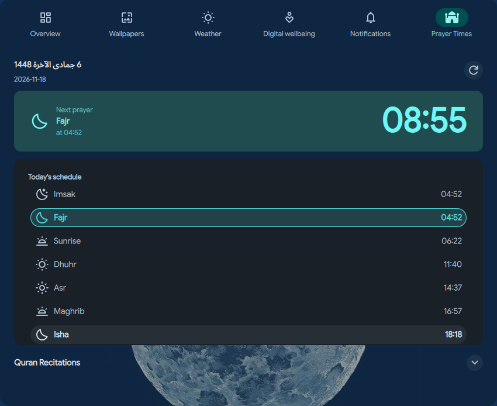

# Prayer Times Enhanced Plugin for Dank Material Shell (DMS)

[](https://github.com/AvengeMedia/DankMaterialShell)
[](https://wayland.freedesktop.org/)
[](https://www.python.org/)
[](https://github.com/Amr-Khaled-Ahmed/dms-prayer-times)

An offline-first Islamic prayer times plugin for [Dank Material Shell](https://github.com/AvengeMedia/DankMaterialShell). It adds a live Dankbar widget, a full Prayer Times Dashboard tab and card, automated Athan audio alerts at prayer times, and an integrated Quran recitation browser/player.

Prayer Times Enhanced is a feature-extended fork of the original [Prayer Times](https://github.com/muadzmo/prayertimes) plugin by **muadz**, adding offline calculation, a Dashboard tab and card, and an integrated Quran player.

Prayer times are calculated locally on your machine. Manual coordinates work without an internet connection, and no location or credentials are hardcoded in the source.

---

## Preview



> **Screenshot placeholder:** additional Dankbar and popout previews can be added here as `assets/prayer-times-bar.png` and `assets/prayer-times-popout.png`.

---

## Overview

**Prayer Times Enhanced** is a composite DMS plugin (Dankbar widget + Dashboard tab + Dashboard card) that keeps the next prayer visible at a glance and provides a complete daily schedule when you need more detail.

- Prayer times are calculated locally with the [`salat`](https://pypi.org/project/salat/) Python library using the **Egyptian General Authority** method and standard Asr calculation.
- The Hijri date is calculated offline using the Kuwaiti algorithm.
- The bar widget shows the current/next prayer and a live countdown.
- The Dashboard tab shows the daily schedule, next-prayer countdown, and an optional Quran section.
- Notifications and Athan playback can be enabled independently.
- Quran recitations are browsed and streamed from the public [mp3quran.net API](https://www.mp3quran.net/ar/api); the reciter list is cached locally. Audio streams are fetched over HTTP.

---

## Features

### Dankbar Widget

- Current or next prayer name with a live countdown directly in the top bar.
- Popout schedule covering Imsak (10 minutes before Fajr), Fajr, Sunrise, Dhuhr, Asr, Maghrib, and Isha.
- Hijri and Gregorian date display.
- Optional icon-only mode and optional seconds in the countdown.
- Optional pre-prayer reminders and prayer-time desktop notifications.
- Optional Athan playback from a local audio file or direct URL.

### Dashboard Tab & Card

- Dedicated **Prayer Times Enhanced** Dashboard tab registered as `plugin_prayerTimesEnhanced`.
- Full interactive daily schedule with the next prayer highlighted.
- Dashboard overview card showing the current period and countdown; clicking it opens the Prayer Times Enhanced tab.
- Responsive layout that works in the regular Dashboard and in Island mode on supported DMS builds.
- Keyboard-friendly navigation and a manual refresh action.

### Quran Recitation Browser & Player

- Browse reciters and riwayah variants from mp3quran.net.
- Searchable reciter picker in both the widget popout and the Dashboard tab.
- Stream any surah through the first available local player: `mpv`, `ffplay`, or `cvlc`.
- Reciter list is cached in `reciters.json` and can be refreshed on demand.
- The Quran section can be hidden entirely from the Dashboard tab.

### Customizable Settings

Configure everything from **Settings → Plugins → Prayer Times Enhanced** and the Dashboard plugin options:

| Setting | Description | Default |
|---|---|---|
| 12-hour format | Display Dashboard prayer times in 12-hour format | Off |
| Show Quran section | Show or hide the Quran section in the Prayer Times Enhanced Dashboard tab | On |
| Icon Only Mode | Show only the prayer icon in the bar | Off |
| Show Seconds | Show seconds in the countdown timer | Off |
| Auto Detect Location | Resolve approximate coordinates via IP-based geolocation | Off |
| Latitude | Manual latitude in decimal degrees (-90 to 90) | Empty |
| Longitude | Manual longitude in decimal degrees (-180 to 180) | Empty |
| UTC Offset | Manual UTC offset in hours (-14 to +14, fractional supported) | Empty |
| Reminder (minutes) | Minutes before prayer to send a notification | 15 |
| Play Athan Sound | Play an audio file when each prayer time starts | Off |
| Athan Sound | Local `.mp3`/`.ogg`/`.wav` path or direct `http(s)` URL | Empty |
| Show Quran Tab in Popout | Add the Quran browser/player tab to the widget popout | On |

> Manual location fields are blank on a fresh install. Set latitude, longitude, and UTC offset before relying on new calculations, or enable **Auto Detect Location**.

---

## Installation

### Requirements

- Dank Material Shell **>= 2.0.0** (required for the DCommon and Dashboard APIs used here)
- Python 3
- `salat` Python library
- Dank Material Shell notifications via the built-in `dms notify` command
- One of `mpv`, `ffplay` (from `ffmpeg`), or `cvlc` (from VLC) for Athan and Quran audio
- Internet access only for auto-location, reciter-list fetching, and audio streaming

Install the Python dependency and an audio player:

```bash
pip install salat

# Arch Linux
sudo pacman -S mpv

# Debian / Ubuntu
sudo apt install mpv
```

### Install the plugin

Clone the repository and link it into the DMS plugin directory:

```bash
git clone https://github.com/Amr-Khaled-Ahmed/dms-prayer-times.git
mkdir -p ~/.config/DankMaterialShell/plugins

ln -s "$PWD/dms-prayer-times" \
  ~/.config/DankMaterialShell/plugins/prayerTimes
```

Or copy the directory instead of symlinking:

```bash
cp -r dms-prayer-times ~/.config/DankMaterialShell/plugins/prayerTimes
```

> On installations that use the legacy `~/.config/dms` path, `~/.config/dms/plugins/` is typically a symlink to `~/.config/DankMaterialShell/plugins/`. Either location works as long as it resolves to the active DMS configuration directory.

### Enable in DMS

1. Open **Settings → Plugins**.
2. Click **Scan for Plugins**.
3. Enable **Prayer Times Enhanced**.
4. Open **Settings → DankBar → Add Widget → Prayer Times Enhanced**.
5. Open the DMS Dashboard and add the **Prayer Times Enhanced** card from the editor if desired.

To open the Dashboard tab from a keybind:

```lua
hl.bind(
    "SUPER + P",
    hl.dsp.exec_cmd("dms ipc call dash open plugin_prayerTimesEnhanced"),
    { description = "Prayer Times Enhanced dashboard" }
)
```

---

## How It Works

1. On startup, on location changes, and hourly, the plugin runs `get_times.py`.
2. In **manual** mode it uses your saved latitude, longitude, and UTC offset and calculates offline.
3. In **auto** mode it resolves approximate coordinates through `ip-api.com`, then calculates locally.
4. Results are written to `cache.json` and rendered immediately by the widget and Dashboard.
5. The Quran panel fetches the reciter list from mp3quran.net and caches it in `reciters.json`.

`cache.json`, `reciters.json`, and `__pycache__/` are generated locally and excluded from Git. Your personal Athan recording in `assets/athan.mp3` is also excluded by default so unlicensed audio is not published accidentally.

### Setting an Athan sound

1. Add a recording you have permission to use to `assets/athan.mp3`, or use any local path or direct URL.
2. Open **Settings → Plugins → Prayer Times Enhanced → Athan Sound** and enter the path.
3. Enable **Play Athan Sound**.

Relative paths resolve from the plugin directory. Check the license of any recording before redistributing it.

---

## Privacy & Security

- No API keys, tokens, passwords, or credentials are stored in this repository.
- No coordinates are hardcoded. Manual location data stays local and is never sent to a service.
- Auto-location sends an HTTP request to `ip-api.com`, which can see your public IP address.
- Quran metadata and HTTP audio requests go to mp3quran.net and its audio hosts.
- Configured Athan URLs are contacted only when playback is requested.
- This codebase is audited for accidental secret commits; generated caches are ignored by Git.

---

## Project Structure

```text
prayerTimes/
├── plugin.json                 # Plugin manifest, components, settings, Dashboard registration
├── PrayerWidget.qml            # Dankbar widget, popout, notifications, Athan, Quran player
├── PrayerDashTab.qml           # Prayer Times Enhanced Dashboard tab and Quran section
├── PrayerDashCard.qml          # Dashboard overview card
├── PrayerSettings.qml          # Plugin settings panel
├── get_times.py                # Offline prayer-time and Hijri-date calculation
├── fetch_reciters.py           # Reciter-list fetcher/cache writer
├── icon.svg                    # Plugin icon
├── assets/
│   └── prayer-times-dashboard.png
├── .gitignore
└── README.md
```

---

## Compatibility

- Wayland compositors supported by Dank Material Shell
- Linux distributions with Python 3, pip, and the required dependencies
- DMS **>= 2.0.0**

---

## Contributing

Issues and pull requests are welcome at
[Amr-Khaled-Ahmed/dms-prayer-times](https://github.com/Amr-Khaled-Ahmed/dms-prayer-times).

When reporting a bug, include your DMS version, distribution, compositor, and any relevant output from `dms run` in a terminal.

---

## Credits

- Maintained by **Amr Khaled Ahmed**
- Original plugin by **muadz**
- Quran reciter metadata and audio provided by [mp3quran.net](https://www.mp3quran.net/)
- Community plugin for [Dank Material Shell](https://github.com/AvengeMedia/DankMaterialShell)
